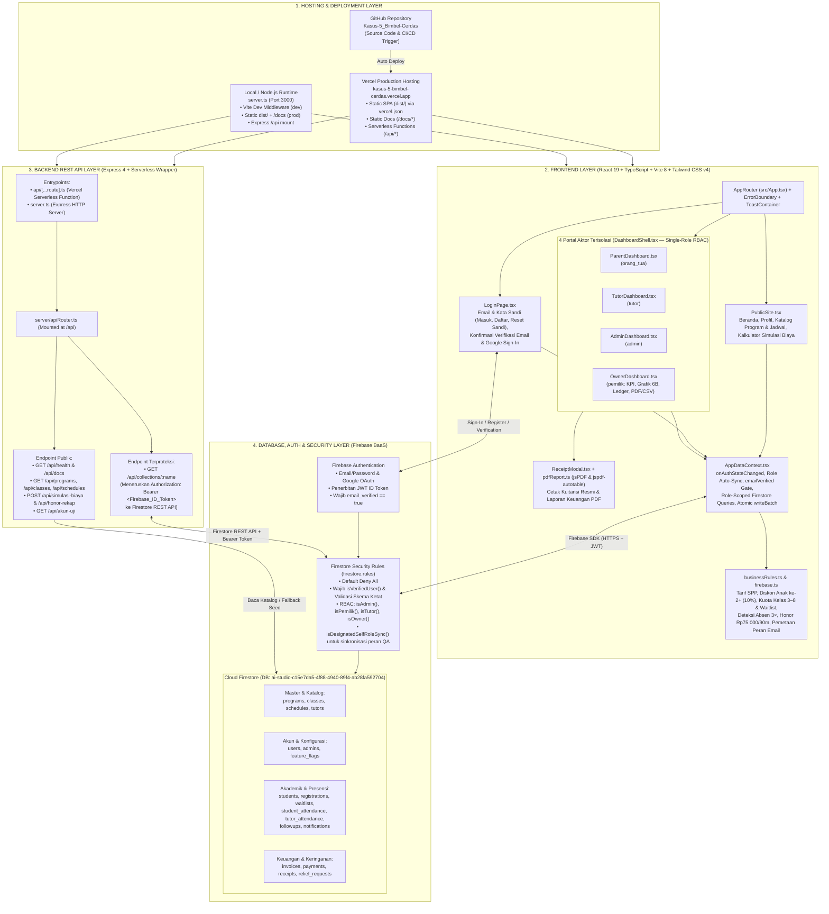

# Diagram Arsitektur Sistem — Bimbel Cerdas

Dokumen ini merangkum arsitektur lengkap **Sistem Informasi Manajemen Bimbel Cerdas** yang terbagi ke dalam 4 lapisan utama: **Hosting**, **Frontend**, **Backend**, dan **Database**.

- **Aplikasi**: Sistem Informasi Manajemen Bimbel Cerdas
- **Domain Produksi (Vercel)**: `https://kasus-5-bimbel-cerdas.vercel.app`
- **Repositori GitHub**: `https://github.com/apfiaguratji/Kasus-5_Bimbel-Cerdas`
- **Firebase Project ID**: `gen-lang-client-0798980042`
- **Cloud Firestore Database ID**: `ai-studio-c15e7da5-4f88-4940-89f4-ab28fa592704`
- **File Diagram Vektor (SVG)**: `public/docs/Diagram_Arsitektur_Bimbel_Cerdas.svg` (dapat dibuka langsung lewat `/docs/Diagram_Arsitektur_Bimbel_Cerdas.svg`)

---

## 1. Diagram Arsitektur Menyeluruh (Mermaid)

---

## 2. Ringkasan Komponen per Lapisan

### A. Hosting & Deployment
| Komponen | File Konfigurasi | Peran |
| :--- | :--- | :--- |
| **Vercel Static & Edge** | `vercel.json` | Menyajikan bundle SPA hasil `npm run build` (`dist/`) dan mengecualikan `/api/*` serta `/docs/*` dari rewrite SPA. |
| **Vercel Serverless** | `api/[...route].ts` | Membungkus `createApiRouter()` menjadi Serverless Function untuk seluruh request `/api/*` di produksi. |
| **Node.js / Express Server** | `server.ts` | Server lokal/Node (port `3000`) yang memasang `/api`, static `/docs` (`public/docs`), dan `vite.middlewares` (dev) atau `dist/` (prod). |

### B. Frontend (Client SPA)
| Komponen | Lokasi File | Tanggung Jawab |
| :--- | :--- | :--- |
| **Router & Error Boundary** | `src/App.tsx`, `src/components/ErrorBoundary.tsx` | Mengatur perpindahan tampilan `public`, `login`, dan portal sesuai `activeRole`. |
| **Halaman Publik** | `src/components/PublicSite.tsx` | Informasi lembaga, katalog program SD/SMP/SMA/UTBK, jadwal, sisa kuota kelas, dan kalkulator simulasi biaya. |
| **Autentikasi** | `src/components/LoginPage.tsx` | Form Email & Kata Sandi (Masuk, Daftar, Reset Sandi), layar Verifikasi Email, dan Google Sign-In. |
| **Portal 4 Aktor** | `src/components/DashboardShell.tsx`, `src/components/dashboards/{Parent,Tutor,Admin,Owner}Dashboard.tsx` | Portal terisolasi Single-Role RBAC sesuai peran pengguna. |
| **Ekspor & Kuitansi** | `src/components/ReceiptModal.tsx`, `src/lib/pdfReport.ts` | Menampilkan kuitansi resmi dan mencetak laporan keuangan PDF/CSV (`jsPDF`). |
| **State & Aturan Bisnis** | `src/context/AppDataContext.tsx`, `src/lib/businessRules.ts`, `src/lib/firebase.ts` | Sinkronisasi auth & Firestore (*role-scoped queries*, `writeBatch`), pemetaan peran email QA, dan seluruh rumus aturan bisnis. |

### C. Backend (REST API)
Seluruh endpoint didefinisikan di `server/apiRouter.ts` dan menggunakan aturan bisnis yang sama dari `src/lib/businessRules.ts`:
- **Publik:**
  - `GET /api/health` — Cek status layanan, Project ID, dan Firestore Database ID.
  - `GET /api/docs` — Daftar spesifikasi endpoint REST API.
  - `GET /api/programs`, `GET /api/classes`, `GET /api/schedules` — Membaca data katalog dari Firestore REST API (dengan fallback data awal).
  - `POST /api/simulasi-biaya` — Menghitung biaya pendaftaran + SPP + diskon anak ke-2+ (10%).
  - `POST /api/honor-rekap` — Menghitung rekap honor tutor Rp75.000/sesi termasuk pengalihan ke tutor pengganti.
- **Terproteksi:**
  - `GET /api/collections/:name` — Mengambil koleksi terproteksi (`students`, `invoices`, `payments`, `receipts`, dll.) dengan mewajibkan header `Authorization: Bearer <Firebase_ID_Token>` agar tetap divalidasi oleh `firestore.rules`.

### D. Database, Autentikasi & Keamanan (Firebase BaaS)
- **Firebase Authentication:** Mendukung **Email/Password** dan **Google OAuth**, dengan kewajiban `email_verified == true` sebelum membaca/menulis data privat.
- **Firestore Security Rules (`firestore.rules`):** Menjalankan validasi skema setiap dokumen, isolasi PII, RBAC (`admin`, `pemilik`, `tutor`, `orang_tua`), dan sinkronisasi peran mandiri khusus email QA terotorisasi (`isDesignatedSelfRoleSync`).
- **Cloud Firestore (`ai-studio-c15e7da5-4f88-4940-89f4-ab28fa592704`):** Menyimpan 18 koleksi operasional terstruktur:
  - *Master & Katalog:* `programs`, `classes`, `schedules`, `tutors`
  - *Akun & Konfigurasi:* `users`, `admins`, `feature_flags`
  - *Akademik & Presensi:* `students`, `registrations`, `waitlists`, `student_attendance`, `tutor_attendance`, `followups`, `notifications`
  - *Keuangan & Keringanan:* `invoices`, `payments`, `receipts`, `relief_requests`
