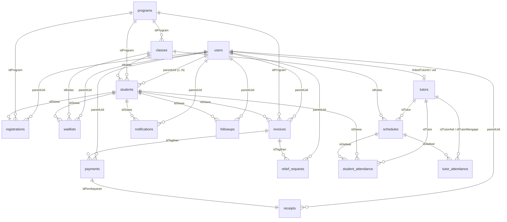

# Skema Database & ERD — Bimbel Cerdas

Dokumen ini mendefinisikan skema lengkap database **Cloud Firestore** untuk **Sistem Informasi Manajemen Bimbel Cerdas**, mengacu langsung pada `firebase-blueprint.json` dan aturan keamanan `firestore.rules`.

- **Database Engine**: Cloud Firestore (NoSQL Document Database)
- **Project ID**: `gen-lang-client-0798980042`
- **Database ID**: `ai-studio-c15e7da5-4f88-4940-89f4-ab28fa592704`
- **Total Koleksi**: **18 Koleksi Operasional** (+ 1 dokumen probe `test/connection`)
- **Diagram ERD Vektor (SVG)**: `public/docs/Skema_Database_Bimbel_Cerdas.svg` (dapat diakses melalui rute `/docs/Skema_Database_Bimbel_Cerdas.svg`)

---

## 1. Entity Relationship Diagram (Mermaid)

---

## 2. Spesifikasi Skema per Koleksi

### A. Akun, RBAC & Konfigurasi

#### 1. `users/{userId}`
Profil pengguna dan penentu hak akses peran tunggal (*Single-Role RBAC*).
| Field | Tipe | Wajib | Constraint / Keterangan |
| :--- | :--- | :--- | :--- |
| `uid` | `string` | Ya | `1–128` char, `^[a-zA-Z0-9_\-]+$`, harus sama dengan `request.auth.uid` |
| `nama` | `string` | Ya | `2–120` char |
| `email` | `string` | Ya | Email, maks `160` char |
| `role` | `string` | Ya | Enum: `'orang_tua' \| 'tutor' \| 'admin' \| 'pemilik'` |
| `noTelepon` | `string` | Tidak | Maks `32` char |
| `alamat` | `string` | Tidak | Maks `300` char |
| `linkedTutorId` | `string` | Tidak | Referensi ke `tutors/{tutorId}`, maks `128` char |
| `statusAktif` | `boolean` | Ya | Status aktif akun |
| `createdAt` | `timestamp` | Ya | Wajib `request.time` saat dibuat |
| `updatedAt` | `timestamp` | Ya | Wajib `request.time` saat dibuat/diperbarui |

#### 2. `admins/{userId}`
Registry UID administrator yang terotorisasi.
- **Document ID**: `{userId}` (`^[a-zA-Z0-9_\-]+$`)
- **Akses**: `get` oleh pemilik UID atau Admin; `list/create/update/delete` hanya Admin.

#### 3. `feature_flags/{flagId}`
Konfigurasi *feature flag* untuk fitur beta khusus Admin (`flagId == key`).
| Field | Tipe | Wajib | Constraint / Keterangan |
| :--- | :--- | :--- | :--- |
| `key` | `string` | Ya | Enum: `'betaAnalyticsForecast' \| 'betaBulkBillingActions' \| 'betaCompactAuditStream'` |
| `label` | `string` | Ya | `2–120` char |
| `description` | `string` | Ya | `2–300` char |
| `targetRole` | `string` | Ya | Tetap `'admin'` |
| `enabled` | `boolean` | Ya | Status aktif flag |
| `updatedBy` | `string` | Tidak | Maks `120` char |
| `createdAt` | `timestamp` | Ya | Server timestamp |
| `updatedAt` | `timestamp` | Ya | Server timestamp |

---

### B. Master & Katalog Pembelajaran

#### 4. `programs/{programId}`
Katalog program bimbingan belajar (dapat dibaca publik).
| Field | Tipe | Wajib | Constraint / Keterangan |
| :--- | :--- | :--- | :--- |
| `namaProgram` | `string` | Ya | `2–100` char |
| `jenjang` | `string` | Ya | Enum: `'SD' \| 'SMP' \| 'SMA' \| 'UTBK'` |
| `biayaSpp` | `number` | Ya | `>= 0` (SD 300rb, SMP 400rb, SMA/UTBK 600rb) |
| `biayaPendaftaran` | `number` | Ya | `>= 0` (Rp100.000) |
| `frekuensiMingguan` | `number` | Ya | `1–7` (default `2` sesi/minggu) |
| `durasiMenit` | `number` | Ya | `30–240` (default `90` menit) |
| `deskripsi` | `string` | Ya | `1–500` char |
| `createdAt` | `timestamp` | Ya | Server timestamp |
| `updatedAt` | `timestamp` | Ya | Server timestamp |

#### 5. `tutors/{tutorId}`
Data profil dan bidang keahlian tutor (hanya dapat dibaca Staff).
| Field | Tipe | Wajib | Constraint / Keterangan |
| :--- | :--- | :--- | :--- |
| `namaTutor` | `string` | Ya | `2–120` char |
| `email` | `string` | Ya | Maks `160` char |
| `noTelepon` | `string` | Ya | `1–32` char |
| `alamat` | `string` | Tidak | Maks `300` char |
| `bidangKeahlian` | `string` | Ya | `1–160` char |
| `uid` | `string` | Tidak | Referensi ke `users/{uid}`, maks `128` char |
| `statusAktif` | `boolean` | Ya | Status aktif mengajar |
| `createdAt` | `timestamp` | Ya | Server timestamp |
| `updatedAt` | `timestamp` | Ya | Server timestamp |

#### 6. `classes/{classId}`
Data kelas belajar dan kuota siswa (dapat dibaca publik).
| Field | Tipe | Wajib | Constraint / Keterangan |
| :--- | :--- | :--- | :--- |
| `idProgram` | `string` | Ya | FK → `programs/{programId}` |
| `namaProgram` | `string` | Ya | `1–100` char (denormalisasi) |
| `jenjang` | `string` | Ya | Enum: `'SD' \| 'SMP' \| 'SMA' \| 'UTBK'` |
| `namaKelas` | `string` | Ya | `2–100` char |
| `kapasitasMaksimal` | `number` | Ya | `1–20` (standar `8`) |
| `jumlahMinimal` | `number` | Ya | `1–10` (standar `3`) |
| `jumlahTerisi` | `number` | Ya | `0–20` |
| `statusKelas` | `string` | Ya | Enum: `'Menunggu Minimal' \| 'Aktif' \| 'Penuh' \| 'Tidak Aktif'` |
| `createdAt` | `timestamp` | Ya | Server timestamp |
| `updatedAt` | `timestamp` | Ya | Server timestamp |

#### 7. `schedules/{scheduleId}`
Jadwal sesi belajar mingguan dan ruangan (dapat dibaca publik).
| Field | Tipe | Wajib | Constraint / Keterangan |
| :--- | :--- | :--- | :--- |
| `idKelas` | `string` | Ya | FK → `classes/{classId}` |
| `namaKelas` | `string` | Ya | `1–100` char |
| `idTutor` | `string` | Ya | FK → `tutors/{tutorId}` |
| `namaTutor` | `string` | Ya | `1–120` char |
| `hari` | `string` | Ya | Enum: `'Senin' \| 'Selasa' \| 'Rabu' \| 'Kamis' \| 'Jumat' \| 'Sabtu' \| 'Minggu'` |
| `jamMulai` | `string` | Ya | `1–10` char (misal `'15:30'`) |
| `jamSelesai` | `string` | Ya | `1–10` char (misal `'17:00'`) |
| `durasiMenit` | `number` | Ya | `30–240` (standar `90`) |
| `ruangan` | `string` | Tidak | Maks `60` char |
| `createdAt` | `timestamp` | Ya | Server timestamp |
| `updatedAt` | `timestamp` | Ya | Server timestamp |

---

### C. Akademik, Pendaftaran & Presensi

#### 8. `students/{studentId}`
Data siswa yang terhubung ke akun Orang Tua (`parentUid`).
| Field | Tipe | Wajib | Constraint / Keterangan |
| :--- | :--- | :--- | :--- |
| `parentUid` | `string` | Ya | FK → `users/{uid}` |
| `parentName` | `string` | Ya | `1–120` char |
| `parentPhone` | `string` | Tidak | Maks `32` char |
| `namaSiswa` | `string` | Ya | `2–120` char |
| `tanggalLahir` | `string` | Ya | `1–20` char (`YYYY-MM-DD`) |
| `jenisKelamin` | `string` | Ya | Enum: `'L' \| 'P'` |
| `asalSekolah` | `string` | Ya | `1–120` char |
| `jenjang` | `string` | Ya | Enum: `'SD' \| 'SMP' \| 'SMA' \| 'UTBK'` |
| `idProgram` | `string` | Ya | FK → `programs/{programId}` |
| `namaProgram` | `string` | Ya | `1–100` char |
| `idKelas` | `string` | Ya | FK → `classes/{classId}` |
| `namaKelas` | `string` | Ya | `1–100` char |
| `urutanAnak` | `number` | Ya | `1–20` (menentukan diskon 10% anak ke-2+) |
| `statusSiswa` | `string` | Ya | Enum: `'Aktif' \| 'Menunggu Kelas' \| 'Daftar Tunggu' \| 'Nonaktif'` |
| `createdAt` | `timestamp` | Ya | Server timestamp |
| `updatedAt` | `timestamp` | Ya | Server timestamp |

#### 9. `registrations/{registrationId}`
Catatan pendaftaran siswa baru beserta biaya pendaftaran tetap Rp100.000.
| Field | Tipe | Wajib | Constraint / Keterangan |
| :--- | :--- | :--- | :--- |
| `parentUid` | `string` | Ya | FK → `users/{uid}` |
| `parentName` | `string` | Ya | `1–120` char |
| `idSiswa` | `string` | Ya | FK → `students/{studentId}` |
| `namaSiswa` | `string` | Ya | `1–120` char |
| `idProgram` | `string` | Ya | FK → `programs/{programId}` |
| `namaProgram` | `string` | Ya | `1–100` char |
| `idKelas` | `string` | Ya | FK → `classes/{classId}` |
| `namaKelas` | `string` | Ya | `1–100` char |
| `biayaPendaftaran` | `number` | Ya | Wajib tepat `100000` |
| `statusBayarDaftar` | `string` | Ya | Enum: `'Belum Bayar' \| 'Lunas'` |
| `statusPendaftaran` | `string` | Ya | Enum: `'Menunggu Verifikasi' \| 'Aktif' \| 'Menunggu Kelas' \| 'Daftar Tunggu' \| 'Ditolak'` |
| `tanggalDaftar` | `string` | Ya | `1–20` char (`YYYY-MM-DD`) |
| `createdAt` | `timestamp` | Ya | Server timestamp |
| `updatedAt` | `timestamp` | Ya | Server timestamp |

#### 10. `waitlists/{waitlistId}`
Antrean otomatis ketika kelas target sudah mencapai kapasitas maksimal (`8` siswa).
| Field | Tipe | Wajib | Constraint / Keterangan |
| :--- | :--- | :--- | :--- |
| `parentUid` | `string` | Ya | FK → `users/{uid}` |
| `idSiswa` | `string` | Ya | FK → `students/{studentId}` |
| `namaSiswa` | `string` | Ya | `1–120` char |
| `idProgram` | `string` | Ya | FK → `programs/{programId}` |
| `idKelas` | `string` | Ya | FK → `classes/{classId}` |
| `namaKelas` | `string` | Ya | `1–100` char |
| `urutanAntrean` | `number` | Ya | `>= 1` |
| `statusAntrean` | `string` | Ya | Enum: `'Menunggu' \| 'Ditempatkan' \| 'Dibatalkan'` |
| `tanggalMasuk` | `string` | Ya | `1–20` char |
| `createdAt` | `timestamp` | Ya | Server timestamp |
| `updatedAt` | `timestamp` | Ya | Server timestamp |

#### 11. `student_attendance/{attendanceId}`
Rekam kehadiran siswa per sesi pertemuan.
| Field | Tipe | Wajib | Constraint / Keterangan |
| :--- | :--- | :--- | :--- |
| `parentUid` | `string` | Ya | FK → `users/{uid}` |
| `idJadwal` | `string` | Ya | FK → `schedules/{scheduleId}` |
| `idKelas` | `string` | Ya | FK → `classes/{classId}` |
| `namaKelas` | `string` | Ya | `1–100` char |
| `idTutor` | `string` | Ya | FK → `tutors/{tutorId}` |
| `tanggal` | `string` | Ya | `1–20` char |
| `idSiswa` | `string` | Ya | FK → `students/{studentId}` |
| `namaSiswa` | `string` | Ya | `1–120` char |
| `statusKehadiran` | `string` | Ya | Enum: `'Hadir' \| 'Tidak Hadir'` |
| `catatan` | `string` | Tidak | Maks `250` char |
| `createdAt` | `timestamp` | Ya | Server timestamp |

#### 12. `tutor_attendance/{tutorAttendanceId}`
Konfirmasi mengajar tutor dan pencatatan honor sesi (reguler maupun tutor pengganti).
| Field | Tipe | Wajib | Constraint / Keterangan |
| :--- | :--- | :--- | :--- |
| `idJadwal` | `string` | Ya | FK → `schedules/{scheduleId}` |
| `idKelas` | `string` | Ya | FK → `classes/{classId}` |
| `namaKelas` | `string` | Ya | `1–100` char |
| `tanggal` | `string` | Ya | `1–20` char |
| `idTutorAsli` | `string` | Ya | FK → `tutors/{tutorId}` |
| `idTutorMengajar` | `string` | Ya | FK → `tutors/{tutorId}` (penerima honor) |
| `namaTutorMengajar` | `string` | Ya | `1–120` char |
| `isPengganti` | `boolean` | Ya | Penanda apakah sesi digantikan |
| `statusHadir` | `boolean` | Ya | `true` jika mengajar, `false` jika absen |
| `durasiMenit` | `number` | Ya | Wajib `90` |
| `honorSesi` | `number` | Ya | Wajib `75000` (hadir) atau `0` (tidak hadir) |
| `createdAt` | `timestamp` | Ya | Server timestamp |

#### 13. `followups/{followupId}`
Tiket tindak lanjut Admin untuk menghubungi orang tua saat siswa tidak hadir `>= 3` kali berturut-turut.
| Field | Tipe | Wajib | Constraint / Keterangan |
| :--- | :--- | :--- | :--- |
| `parentUid` | `string` | Ya | FK → `users/{uid}` |
| `idSiswa` | `string` | Ya | FK → `students/{studentId}` |
| `namaSiswa` | `string` | Ya | `1–120` char |
| `namaParent` | `string` | Ya | `1–120` char |
| `noTeleponParent` | `string` | Ya | `1–32` char |
| `jumlahAbsenBeruntun` | `number` | Ya | Wajib `>= 3` |
| `tanggalPemicu` | `string` | Ya | `1–20` char |
| `statusTindakLanjut` | `string` | Ya | Enum: `'Menunggu Telepon' \| 'Sedang Dihubungi' \| 'Selesai'` |
| `hasilPanggilan` | `string` | Tidak | Maks `500` char |
| `ditindakOleh` | `string` | Tidak | Maks `120` char |
| `tanggalTindakLanjut` | `string` | Tidak | Maks `20` char |
| `createdAt` | `timestamp` | Ya | Server timestamp |
| `updatedAt` | `timestamp` | Ya | Server timestamp |

#### 14. `notifications/{notificationId}`
Notifikasi otomatis ke akun Orang Tua.
| Field | Tipe | Wajib | Constraint / Keterangan |
| :--- | :--- | :--- | :--- |
| `parentUid` | `string` | Ya | FK → `users/{uid}` |
| `idSiswa` | `string` | Ya | FK → `students/{studentId}` |
| `judul` | `string` | Ya | `1–140` char |
| `pesan` | `string` | Ya | `1–500` char |
| `kategori` | `string` | Ya | Enum: `'Absensi 3x' \| 'Pendaftaran' \| 'Tagihan' \| 'Keringanan'` |
| `sudahDibaca` | `boolean` | Ya | Orang tua hanya boleh mengubah field ini |
| `createdAt` | `timestamp` | Ya | Server timestamp |

---

### D. Keuangan, Kuitansi & Keringanan

#### 15. `invoices/{invoiceId}`
Tagihan SPP bulanan per siswa.
| Field | Tipe | Wajib | Constraint / Keterangan |
| :--- | :--- | :--- | :--- |
| `parentUid` | `string` | Ya | FK → `users/{uid}` |
| `idSiswa` | `string` | Ya | FK → `students/{studentId}` |
| `namaSiswa` | `string` | Ya | `1–120` char |
| `idProgram` | `string` | Ya | FK → `programs/{programId}` |
| `namaProgram` | `string` | Ya | `1–100` char |
| `bulan` | `number` | Ya | `1–12` |
| `tahun` | `number` | Ya | `2024–2100` |
| `periodeLabel` | `string` | Ya | `1–40` char (misal `'November 2026'`) |
| `nominalDasar` | `number` | Ya | `>= 0` |
| `diskonPersen` | `number` | Ya | Wajib `0` atau `10` |
| `nominalDiskon` | `number` | Ya | `>= 0` |
| `jumlahTagihan` | `number` | Ya | `>= 0` (`nominalDasar - nominalDiskon`) |
| `jatuhTempo` | `string` | Ya | `1–20` char |
| `statusTagihan` | `string` | Ya | Enum: `'Belum Bayar' \| 'Lunas' \| 'Tunggakan'` |
| `createdAt` | `timestamp` | Ya | Server timestamp |
| `updatedAt` | `timestamp` | Ya | Server timestamp |

#### 16. `payments/{paymentId}`
Catatan pembayaran masuk yang diverifikasi oleh Admin.
| Field | Tipe | Wajib | Constraint / Keterangan |
| :--- | :--- | :--- | :--- |
| `parentUid` | `string` | Ya | FK → `users/{uid}` |
| `idTagihan` | `string` | Ya | FK → `invoices/{invoiceId}` (atau ID registrasi) |
| `idSiswa` | `string` | Ya | FK → `students/{studentId}` |
| `namaSiswa` | `string` | Ya | `1–120` char |
| `jenisPembayaran` | `string` | Ya | Enum: `'SPP' \| 'Pendaftaran'` |
| `jumlahBayar` | `number` | Ya | `>= 0` |
| `metodeBayar` | `string` | Ya | Enum: `'Transfer Bank' \| 'QRIS' \| 'Tunai'` |
| `tanggalBayar` | `string` | Ya | `1–20` char |
| `dicatatOleh` | `string` | Ya | `1–120` char |
| `nomorKuitansi` | `string` | Ya | `1–60` char (`KW-BC-YYYYMMDD-XXXX`) |
| `createdAt` | `timestamp` | Ya | Server timestamp |

#### 17. `receipts/{receiptId}`
Arsip kuitansi resmi digital.
| Field | Tipe | Wajib | Constraint / Keterangan |
| :--- | :--- | :--- | :--- |
| `nomorKuitansi` | `string` | Ya | `1–60` char |
| `parentUid` | `string` | Ya | FK → `users/{uid}` |
| `idPembayaran` | `string` | Ya | FK → `payments/{paymentId}` |
| `idTagihan` | `string` | Ya | FK → `invoices/{invoiceId}` |
| `namaSiswa` | `string` | Ya | `1–120` char |
| `namaOrangTua` | `string` | Ya | `1–120` char |
| `jenisPembayaran` | `string` | Ya | Enum: `'SPP' \| 'Pendaftaran'` |
| `periode` | `string` | Ya | `1–50` char |
| `nominalDasar` | `number` | Ya | `>= 0` |
| `diskonPersen` | `number` | Ya | `>= 0` |
| `jumlahBayar` | `number` | Ya | `>= 0` |
| `metodeBayar` | `string` | Ya | `1–40` char |
| `tanggalBayar` | `string` | Ya | `1–20` char |
| `adminPencatat` | `string` | Ya | `1–120` char |
| `createdAt` | `timestamp` | Ya | Server timestamp |

#### 18. `relief_requests/{reliefId}`
Pengajuan keringanan atau penundaan jatuh tempo dari Orang Tua yang diputuskan Pemilik.
| Field | Tipe | Wajib | Constraint / Keterangan |
| :--- | :--- | :--- | :--- |
| `parentUid` | `string` | Ya | FK → `users/{uid}` |
| `idTagihan` | `string` | Ya | FK → `invoices/{invoiceId}` |
| `idSiswa` | `string` | Ya | FK → `students/{studentId}` |
| `namaSiswa` | `string` | Ya | `1–120` char |
| `periode` | `string` | Ya | `1–40` char |
| `jumlahTagihan` | `number` | Ya | `>= 0` |
| `jenisPengajuan` | `string` | Ya | Enum: `'Keringanan Nominal' \| 'Penundaan Jatuh Tempo'` |
| `alasan` | `string` | Ya | `5–500` char |
| `statusKeputusan` | `string` | Ya | Enum: `'Menunggu' \| 'Disetujui' \| 'Ditolak'` |
| `catatanPemilik` | `string` | Tidak | Maks `300` char |
| `tanggalPengajuan` | `string` | Ya | `1–20` char |
| `tanggalKeputusan` | `string` | Tidak | Maks `20` char |
| `createdAt` | `timestamp` | Ya | Server timestamp |
| `updatedAt` | `timestamp` | Ya | Server timestamp |

#### 19. Dokumen Probe Konektivitas: `test/connection`
Digunakan `testConnection()` saat startup untuk memverifikasi konektivitas klien ke Firestore (`allow get: if true`).
